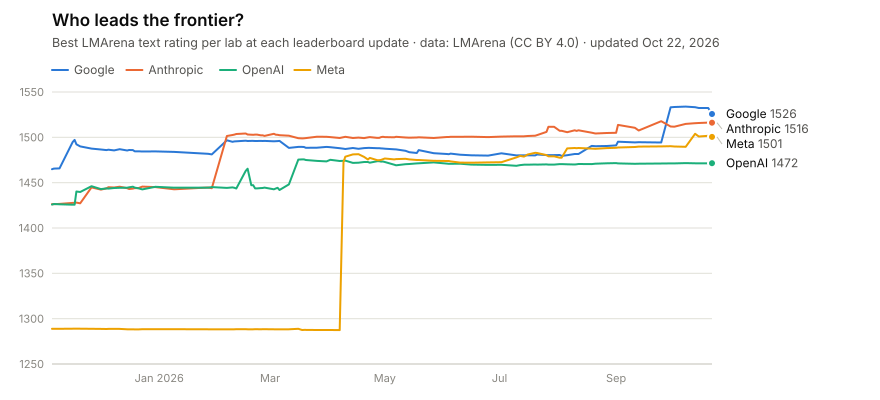

# model-pulse

A daily check on the frontier AI models, built from public leaderboards that often disagree with each other.

Each day a GitHub Action pulls human-preference rankings (LMArena), a benchmark-based capability score (Epoch AI) and live serving data (OpenRouter). It puts them side by side and records what changed: a model sliding in the rankings, a price cut, or a provider quietly switching to lower-precision weights.

<picture>
  <source media="(prefers-color-scheme: dark)" srcset="chart-dark.svg">
  
</picture>

## Today

<!-- pulse:start -->
_Snapshot 2026-10-30 · LMArena published 2026-10-28_

| Model | LMArena text | LMArena WebDev | Epoch ECI | Providers | Uptime 24h | Cheapest output $/M | Precision |
|---|---|---|---|---|---|---|---|
| Gemini 4 Argon | #2 (1529) | #11 | 166.32 | 6 | 98.7% | $5.00 | — |
| Claude Opus 5.5 | #3 (1516) | #1 | 168.64 | 11 | 100% | $20.00 | — |
| Claude Fable 5.1 | #4 (1514) | #6 | 166.19 | 4 | 100% | $50.00 | — |
| Claude Sonnet 5.5 | #30 (1473) | #3 | 165.98 | 10 | 100% | $10.00 | — |
| GPT-6.1 Sol | #62 (1446) | #5 | 168.2 | 9 | 98.2% | $5.00 | — |
| GPT-6 Astra | #75 (1441) | #2 | 168.92 | 8 | 97.6% | $25.00 | — |
| Muse Wonder | #8 (1499) | #20 | 161.84 | 1 | 98.5% | $20.00 | — |
| Grok 4.7 | #158 (1398) | #21 | 154.4 | 5 | 100% | $6.00 | — |
| Kimi K3 | #25 (1476) | #18 | 157.86 | 30 | 99.1% | $7.50 | fp4/fp8/mxfp4 |
| Gemma 4 31B (open) | #68 (1443) | #114 | — | 16 | 97.9% | $0.32 | bf16/fp4/fp8 |

**Changes since the last snapshot**

- Gemini 4 Argon: Epoch ECI 166.45 → 166.32
- Claude Opus 5.5: Epoch ECI 168.83 → 168.64
- Claude Fable 5.1: Epoch ECI 166.49 → 166.19
- Claude Sonnet 5.5: Epoch ECI 166.18 → 165.98
- GPT-6.1 Sol: Epoch ECI 168.37 → 168.2
- GPT-6.1 Sol: providers 8 → 9
- GPT-6 Astra: Epoch ECI 168.81 → 168.92
- GPT-6 Astra: providers 7 → 8
- Muse Wonder: Epoch ECI 161.85 → 161.84
- Grok 4.7: Epoch ECI 154.37 → 154.4
- Kimi K3: cheapest output $/M 8.25 → 7.5
<!-- pulse:end -->

## How to read it

- **LMArena text / WebDev:** rank (and rating) from people blind-voting between two models' answers. The best variant counts (e.g. `High`/`Max` reasoning).
- **Epoch ECI:** the Epoch Capabilities Index, one score combining many benchmarks.
- **Providers / uptime / price / precision:** from OpenRouter's public endpoints API. Precision lists the number formats providers publicly declare (`bf16`, `fp8`, `fp4`). Lower precision is cheaper to serve and can cost quality.

When the leaderboards disagree, that's information, not noise. A model can top the benchmarks and still lose the chat vote.

## How it works

`pulse.py` (stdlib + `pyarrow`) runs daily in [`.github/workflows/pulse.yml`](.github/workflows/pulse.yml). It:

1. downloads the sources,
2. matches the models in [`models.json`](models.json) across them (each source names models differently),
3. appends every value to [`data/history.csv`](data/history.csv),
4. redraws the chart and this README.

A source that changes its format makes the run fail loudly instead of publishing wrong numbers. To track other models, edit `models.json`.

```bash
pip install pyarrow && python -m unittest && python pulse.py
```

## Data and credit

- [LMArena leaderboard dataset](https://huggingface.co/datasets/lmarena-ai/leaderboard-dataset), CC BY 4.0
- [Epoch AI, "Capabilities & benchmarking"](https://epoch.ai/benchmarks), CC BY 4.0
- [OpenRouter](https://openrouter.ai) public models API

Code: MIT.
