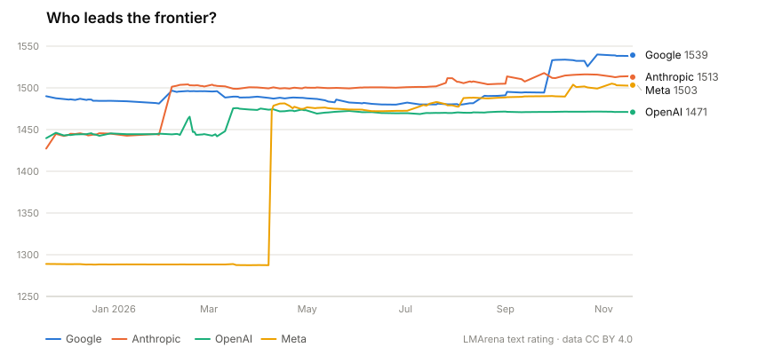

# model-pulse

A daily check on the frontier AI models, built from public leaderboards that often disagree with each other.

Each day a GitHub Action pulls human-preference rankings (LMArena), a benchmark-based capability score (Epoch AI) and live serving data (OpenRouter). It puts them side by side and records what changed: a model sliding in the rankings, a price cut, or a provider quietly switching to lower-precision weights.

<picture>
  <source media="(prefers-color-scheme: dark)" srcset="chart-dark.svg">
  
</picture>

## Today

<!-- pulse:start -->
_Snapshot 2026-11-20 · LMArena published 2026-11-19_

| Model | LMArena text | LMArena WebDev | Epoch ECI | Providers | Uptime 24h | Cheapest output $/M | Precision |
|---|---|---|---|---|---|---|---|
| Gemini 4 Argon | #2 (1528) | #18 | 166.53 | 5 | 99.1% | $5.00 | — |
| Claude Opus 5.5 | #4 (1513) | #2 | 168.67 | 6 | 100% | $20.00 | — |
| Claude Fable 5.1 | #5 (1512) | #11 | 167.06 | 3 | 99.9% | $50.00 | — |
| Claude Sonnet 5.5 | #35 (1470) | #3 | 166.6 | 5 | 100% | $10.00 | — |
| GPT-6.1 Sol | #63 (1446) | #10 | 168.61 | 6 | 97.6% | $5.00 | — |
| GPT-6 Astra | #79 (1441) | #6 | 169.21 | 6 | 99.1% | $25.00 | — |
| Muse Wonder | #7 (1503) | #27 | 161.74 | 2 | 99.8% | $20.00 | — |
| Grok 4.7 | #163 (1400) | #29 | 156.43 | 5 | 98.4% | $6.00 | — |
| Kimi K3 | #29 (1475) | #23 | 158.61 | 29 | 99.1% | $9.50 | fp4/fp8/mxfp4 |
| Gemma 4 31B (open) | #75 (1442) | #122 | — | 18 | 99.3% | $0.10 | bf16/fp4/fp8 |

**Changes since the last snapshot**

- Gemini 4 Argon: LMArena text rank 3 → 2
- Gemini 4 Argon: Epoch ECI 166.57 → 166.53
- Claude Opus 5.5: Epoch ECI 168.7 → 168.67
- Claude Fable 5.1: Epoch ECI 167.09 → 167.06
- Claude Sonnet 5.5: LMArena text rank 34 → 35
- Claude Sonnet 5.5: WebDev rank 4 → 3
- Claude Sonnet 5.5: Epoch ECI 166.59 → 166.6
- GPT-6.1 Sol: LMArena text rank 62 → 63
- GPT-6.1 Sol: Epoch ECI 168.63 → 168.61
- GPT-6 Astra: LMArena text rank 78 → 79
- GPT-6 Astra: WebDev rank 7 → 6
- GPT-6 Astra: Epoch ECI 169.2 → 169.21
- Muse Wonder: WebDev rank 26 → 27
- Grok 4.7: LMArena text rank 160 → 163
- Grok 4.7: WebDev rank 28 → 29
- Kimi K3: LMArena text rank 30 → 29
- Kimi K3: Epoch ECI 158.6 → 158.61
- Gemma 4 31B (open): LMArena text rank 73 → 75
- Gemma 4 31B (open): WebDev rank 121 → 122
<!-- pulse:end -->

## How to read it

- **LMArena text / WebDev:** rank (and rating) from people blind-voting between two models' answers. The best variant counts (e.g. `High`/`Max` reasoning).
- **Epoch ECI:** the Epoch Capabilities Index, one score combining many benchmarks.
- **Providers / uptime / price / precision:** from OpenRouter's public endpoints API. Precision lists the number formats providers publicly declare (`bf16`, `fp8`, `fp4`). Lower precision is cheaper to serve and can cost quality.

When the leaderboards disagree, that's information, not noise. A model can top the benchmarks and still lose the chat vote.

## How it works

`pulse.py` (stdlib + `pyarrow`) runs daily in [`.github/workflows/pulse.yml`](.github/workflows/pulse.yml). It:

1. downloads the sources,
2. matches the models in [`models.json`](models.json) across them (each source names models differently),
3. appends every value to [`data/history.csv`](data/history.csv),
4. redraws the chart and this README.

A source that changes its format makes the run fail loudly instead of publishing wrong numbers. To track other models, edit `models.json`.

```bash
pip install pyarrow && python -m unittest && python pulse.py
```

## Data and credit

- [LMArena leaderboard dataset](https://huggingface.co/datasets/lmarena-ai/leaderboard-dataset), CC BY 4.0
- [Epoch AI, "Capabilities & benchmarking"](https://epoch.ai/benchmarks), CC BY 4.0
- [OpenRouter](https://openrouter.ai) public models API

Code: MIT.
